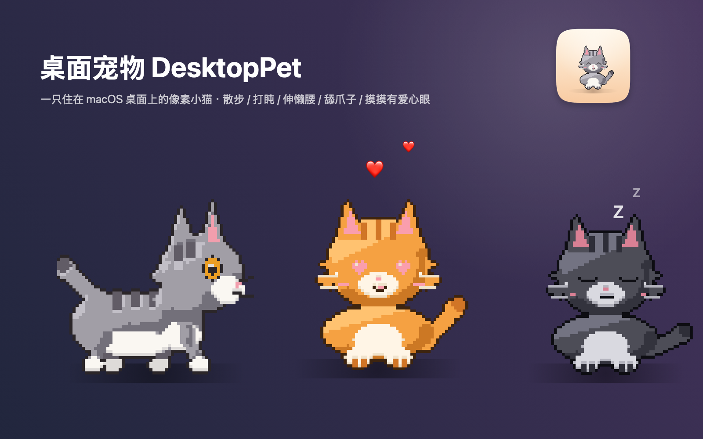

# 桌面宠物 DesktopPet 🐱

<p align="center">
  
</p>

<p align="center">
  一只程序化绘制的像素小猫，住在你的 macOS 桌面上。<br>
  纯 Swift + AppKit，零第三方依赖，安装包不到 1 MB。
</p>

<p align="center">
  <a href="https://github.com/Su-anAcid/DesktopPet/releases/latest"></a>
  
  
  
</p>

---

## ✨ 特性

- **一整套动作状态机**：散步 → 发呆 → 睡觉，睡醒伸懒腰；点击坐下前会舔 2~3 遍爪子、扫扫地、起身还要左右张望一下再走
- **真实的猫神态**：平时是琥珀色大眼 / 眯眼微笑，**持续抚摸才切换爱心眼**，睡觉冒 Z
- **交互**：左键拖动移动 · 单击摸猫（爱心粒子）· 右键打开设置菜单 · 菜单栏常驻图标（找回 / 隐藏猫咪）
- **打卡日历** 🗓️：每天点一次「今天打卡」，猫会开心冒爱心；月历留痕、连续 / 最长 / 累计天数统计，连续打卡命中 1/3/7/30… 天还有里程碑彩蛋
- **学习计时** ⏱️：打卡页一键开始 / 暂停，按自然日累计（休眠时间不计入）；日历格子直接显示每天学了多久（45m / 1.5h），并按 **五档暖色色阶**着色，一眼看出哪天最努力
- **事件倒计时** ⏳：记下生日、上线、考试等日子，随时看到还剩几天；支持每年重复，猫会顶着对话气泡主动播报「距离 xx 还有 N 天」，点气泡直达面板
- **提醒设置** 🔔：猫的「嘴」由你管——倒计时提醒可关、可设提前 30 天 / 7 天 / 仅当天才开始念、间隔每天 / 3 天 / 7 天；学习计时中每过 5 / 10 / 15 / 30 分钟（或自定义任意分钟数）猫会冒泡播报「已经学了多久」，打卡成功也顺嘴报一句。全在工具面板第三个 tab「提醒」里
- **自定义**：3 种毛色（灰虎斑 / 橘猫 / 黑猫）× 3 档大小 × 3 档动作节奏；固定位置、坐下前舔爪子开关
- **成熟细节**：设置自动持久化（重启恢复）、开机自启动、单实例保护、Retina 像素对齐（任何缩放下像素方块不糊不分格）
- **跨平台**：macOS 原生版 + Windows 单文件版

## 📦 下载安装

到 [**Releases**](https://github.com/Su-anAcid/DesktopPet/releases/latest) 页面下载：

| 文件 | 说明 |
| --- | --- |
| `DesktopPet-x.x.x.dmg` | macOS 安装镜像（Apple Silicon + Intel 通用） |
| `DesktopPet-x.x.x.zip` | macOS zip 备用渠道 |

**安装步骤**：打开 dmg，把 🐱 DesktopPet 拖进 Applications，双击启动。

> **首次打开提示"无法验证开发者"？**
> 本项目没有付费开发者证书（无公证），macOS Gatekeeper 会拦一次。两种解法任选：
>
> 1. 在「应用程序」里 **右键 DesktopPet → 打开 → 打开**（只需一次）；
> 2. 或在终端执行：
>    ```bash
>    xattr -dr com.apple.quarantine /Applications/DesktopPet.app
>    ```

**一键安装**（自动下载最新版并处理好以上一切）：

```bash
curl -fsSL https://raw.githubusercontent.com/Su-anAcid/DesktopPet/main/install.sh | bash
```

## 🎮 玩法

| 操作 | 效果 |
| --- | --- |
| 左键拖动 | 移动小猫 |
| 单击 | 摸猫 → 坐下（会先舔爪子） |
| 连续摸 | 爱心眼 + 爱心粒子 |
| 右键 | 设置菜单：毛色 / 大小 / 节奏 / 睡觉 / 固定位置 / 开机启动 / 打卡日历 / 事件倒计时 / 提醒一下倒计时 / 提醒设置 |
| 菜单栏猫头图标 | 显示 / 隐藏猫咪 · 回到右下角 · 打卡日历 / 事件倒计时 / 提醒设置 · 退出 |
| 等着别动 | 它会自己散步、发呆、睡觉（冒 Z）；每天开机还会用气泡报一下最近的倒计时 |

## 🪟 Windows 版

单文件 `DesktopPet.exe`（约 800 KB，逐像素 alpha 分层窗口，仅依赖系统 DLL），功能与 macOS 版对齐。

获取方式二选一：

1. 在仓库的 Release 或 Actions 产物中下载已编译好的 `DesktopPet.exe`；
2. 自行编译（需要 zig 或 mingw-w64 + node，精灵数据已包含在仓库里）：

   ```bash
   git clone https://github.com/Su-anAcid/DesktopPet.git
   cd DesktopPet/Windows && SKIP_EXPORT=1 ./build-win.sh
   # 产物: Windows/build/DesktopPet.exe
   ```

## 🔨 从源码构建（macOS）

```bash
git clone https://github.com/Su-anAcid/DesktopPet.git
cd DesktopPet
./build.sh        # 开发构建并启动（build/DesktopPet.app）
./release.sh 1.0.0  # 发布打包：通用二进制 + DMG/ZIP → dist/
```

要求：macOS 11+，Xcode Command Line Tools（`xcode-select --install`）。

## 📁 项目结构

```
├── Sources/            macOS 版（纯 Swift）
│   ├── SpriteData.swift   程序化像素画：几何光栅化生成 76 帧 + 3 套调色板
│   ├── App.swift          状态机 / 透明置顶窗口 / 菜单 / 设置持久化
│   ├── IconGen.swift      应用图标生成器
│   └── PromoGen.swift     README 宣传图生成器
├── Windows/            Windows 版（Win32 C++，精灵数据编进 exe）
├── Support/Info.plist
├── docs/               图片素材
└── .github/workflows   推送 vX.Y.Z tag 自动构建并发布 Release
```

## 🧠 技术要点（给想改代码的你）

- **像素画全部由代码生成**：`PixelCanvas` 用椭圆 / 三角 / 线段光栅化出 64×64 网格，带体积明暗（左上受光、右下压暗）、描边与图层旋转（舔爪时头部真的绕脖子转）
- **Retina 不糊的关键**：渲染成 1:1 原始分辨率 `CGImage`，绘制时按「整数个物理像素」放大并把原点吸附到物理像素边界
- **透明置顶窗口**：`NSPanel(.borderless + .nonactivatingPanel)`；Windows 侧用 `UpdateLayeredWindow` 逐像素 alpha
- 改动作 / 加毛色只需动 `SpriteData.swift`，图标和宣传图会跟着重新生成

## 📄 许可证

[MIT](LICENSE) · 欢迎自由使用、修改与二次分发
